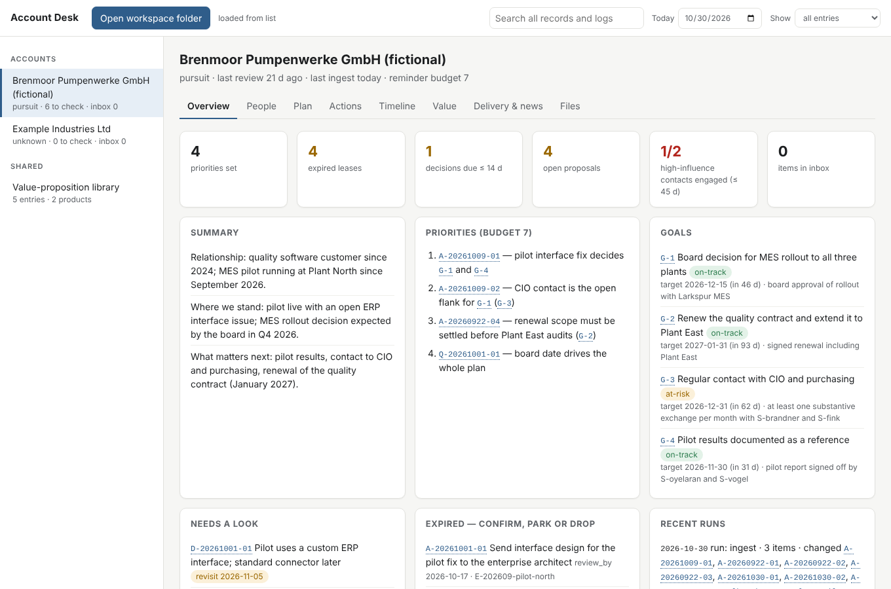

# Sales Copilot

Skills, conventions and templates for a personal, file-based key-account desk run with an AI assistant (Claude, or any harness that reads [Agent Skills](https://agentskills.io)).

The account memory is a folder of plain Markdown files. The assistant is a clerk for that folder: it files what you drop, prepares you for meetings, brings you up to speed on an account, turns meeting notes into actions, and matches client challenges against your value-proposition library. It never sends anything to anyone and never writes to a CRM.

> **This repository contains no account data, and must never contain any.** Real accounts live in a private workspace outside the repository. The only example data is fictional (`examples/`).

## What it does

| Skill | You say | You get |
| --- | --- | --- |
| `drop` | "drop this into <account>" + a mail, file or note | filed in the account's inbox and processed; three-line answer |
| `ingest` | "process the inbox" (also called by the others) | comm-log, stakeholder, action, delivery and proposal updates; injected instructions reported, not followed |
| `prep` | "prep me for the meeting with …" | one page: people, where we stand, what they will raise, what we want, open items, questions (read-only) |
| `review` | "review <account>", "get me up to speed" | situation, plan vs reality, decisions you must make, expired items, at most N priorities with reasons |
| `debrief` | meeting notes + "debrief" | actions with IDs and dependencies, decisions, new people, value-proposition signals, public-source research |
| `vp` | a client challenge | ranked value propositions from your library, with proof, gaps and product-alignment flags; drafts where nothing fits |
| `rebase` | "a lot changed: …" | every open item re-dispositioned in one batch (keep, rewrite, superseded, park, done); episodes closed |
| `new-account` | "new account: …" | an account folder created from the templates |

## Design in five rules

1. **Files are the system.** One folder per account, Markdown with YAML front matter. Any editor, any model, no installation.
2. **Head and history.** Each file has `## Current` (what is true now) and an append-only `## History`. Reminders come only from Current.
3. **Leases.** Actions, questions, signals and delivery items carry `review_by`. Expired items are not reminders; they are listed once for confirm, park or drop. A reminder budget caps every list.
4. **Propose, don't act.** CRM updates, goal changes, merges and inferred people are proposals the account manager decides on.
5. **Private by default.** Every entry carries `vis: private | team | crm`. Nothing reaches the CRM unless the account manager marks it `crm` and enters it.

Details: [CONVENTIONS.md](CONVENTIONS.md) (file format), [POLICY.md](POLICY.md) (hard rules), [docs/design.md](docs/design.md) (rationale).

## Viewer

`Account-Desk-Viewer.html` (in every workspace; source in `viewer/`) is a single HTML file you open by double-click in Edge, Chrome, Safari or Firefox. It reads the workspace folder you choose and shows an overview per account: what needs a look, priorities, goals, a stakeholder map (influence × stance, coloured by how recent the last contact is), actions with dependencies and leases, a timeline across all files, value propositions, delivery and news, the raw files, and the shared value-proposition library.

- Read-only: it never writes to the folder.
- Offline: a content security policy blocks every network request; there are no external scripts or fonts.
- Nothing is stored; closing the tab forgets everything. In Edge and Chrome, "Reload" re-reads the folder after a skill run; other browsers ask you to choose the folder again.
- Presentation mode ("Show: team + crm" or "crm only") hides private entries, untagged content and raw files before you share your screen.



## Setup without installing anything

You need the Claude desktop app and a private folder (a OneDrive folder works well because it keeps file versions). No Python, no git.

1. From the [latest release](https://github.com/nhilbert/Sales-Copilot/releases/latest) download:
   - `sales-copilot-workspace.zip` (empty desk) or `sales-copilot-demo-workspace.zip` (fictional demo)
   - `sales-copilot-skills.zip` (contains one zip per skill)
2. Unzip the workspace into your private folder. Never put it into a shared or public location.
3. In the Claude desktop app, upload each skill zip in the skill settings.
4. Create a Project, paste the text from `PROJECT-INSTRUCTIONS.md` (in the workspace) into its instructions, and connect the workspace folder.
5. Start a chat in the Project: "new account: Example Industries" — then drop material into it.

Start every task in a new chat; the files carry the state. Each skill run leaves a line in the account's `README.md` History, so changes stay attributable without version control.

**Updates:** download `sales-copilot-rules-update.zip` and unzip it over the workspace (it contains only rules, templates and skill copies, never accounts), and re-upload changed skill zips.

## For maintainers (Python 3.9+, git optional)

```bash
git clone https://github.com/nhilbert/Sales-Copilot.git && cd Sales-Copilot
python3 tools/desk.py release              # builds all download zips into dist/
python3 tools/desk.py demo ~/AccountDesk-demo
python3 tools/lint.py ~/AccountDesk-demo/accounts --today 2026-10-30
```

Publishing a GitHub release runs `.github/workflows/release.yml`, which lints the demo and attaches the zips to the release. `tools/lint.py` checks a workspace's format (the skills check themselves against CONVENTIONS §14 and do not need it).

With **Claude Code**, run `claude` inside a workspace: `CLAUDE.md`, `.claude/skills/` and `.claude/settings.json` (deny rules for policy files, `rm`, `curl`, `git push`) are picked up automatically.

### Other harnesses

The skills follow the Agent Skills format (`SKILL.md` with `name` and `description`). They are copied to `.agents/skills/` and `.claude/skills/`, which Codex CLI, goose, opencode and OpenHands read; `AGENTS.md` is the shared instruction file. Permission rules are not portable: re-create the rules in POLICY.md's enforcement table for each harness.

## Keeping the public repository clean

- `tools/desk.py` refuses to create a workspace inside this repository.
- `.gitignore` blocks `accounts/`, `inbox/`, `archive/` and mail or export files outside `examples/`.
- `tools/public_guard.py` checks staged files against a private denylist kept outside the repository (`~/.config/sales-copilot/denylist.txt`) and can run as a pre-commit hook. It reports only the term's line number, never the term.

## Status

Early. The skills are written and the example lints clean; they have not yet been tuned on real use. Expect a week of iteration per skill. Model-specific adjustments go into [MODEL-NOTES.md](MODEL-NOTES.md).

## Credits

Ideas borrowed, no code copied:

- [Agent Skills](https://agentskills.io) open standard — skill format and progressive loading.
- Anthropic [knowledge-work-plugins](https://github.com/anthropics/knowledge-work-plugins) (sales) — shape of call prep, call summary and account planning skills.
- [orbit](https://github.com/tobiaswuerth/orbit) — a source for every fact; read-only access as a first-class mode.
- [mem0](https://docs.mem0.ai/platform/features/expiration-date) — expiry dates on memories (here: leases). [Graphiti](https://github.com/getzep/graphiti) — invalidate instead of delete. [Letta MemFS](https://docs.letta.com/letta-code/memfs) — git-backed Markdown memory and consolidation passes.
- Simon Willison, ["The lethal trifecta"](https://simonwillison.net/2025/Jun/16/the-lethal-trifecta/) (2025), and [OWASP LLM01:2025](https://genai.owasp.org/llmrisk/llm01-prompt-injection/) — why the desk has no outbound channel.
- Sales practice: buying roles after Miller Heiman *Strategic Selling*; qualification ideas from MEDDPICC; account-plan components after SAMA; value word equations after Anderson, Narus and Van Rossum, "Customer Value Propositions in Business Markets", *HBR* 2006. No trademarked templates are reproduced.

## Licence

[MIT](LICENSE).
